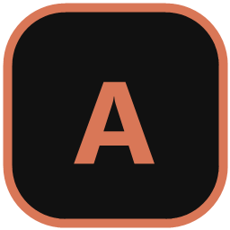

<div align="center">



# Agentory

**Many Claude Code sessions. One window.**

A native Windows desktop app that runs the real [Claude Code](https://claude.com/claude-code) TUI in
as many parallel sessions as you need, each optionally isolated in its own git worktree, with
per-project skill management built in.

[](https://github.com/EvilPrime98/agentory/actions/workflows/ci.yml)
[](https://github.com/EvilPrime98/agentory/releases)


[](LICENSE)

<!-- TODO: replace with a screenshot of several sessions running (status dots visible) -->


</div>

## Why Agentory

Running Claude Code on more than one task usually means a pile of terminal windows and no idea which
one is waiting on you. Agentory puts them in one place and tells you.

- **Real Claude Code, not a wrapper.** Each session is the actual `claude` TUI in an embedded PTY
  (ConPTY), rendered by a `vt100` terminal grid. Permission prompts, slash commands and everything
  else behave exactly as in your terminal.
- **Project sidebar with live status.** Sessions are grouped under their project, and a status dot
  shows whether each one is working, waiting for input, or done.
- **Worktree isolation.** Start a session in a fresh `git worktree` on its own branch
  (`agentory/<id>`) so parallel agents never step on each other's files.
- **Skills, managed per project.** A built-in skills page reads `spm.json` and `.claude/skills`,
  installs, updates and removes skills through the [`spm`](https://github.com/EvilPrime98/mySkills)
  CLI, and shows each skill's context cost via `spm doctor`.
- **Touches nothing of yours.** Status comes from hooks injected with
  `claude --settings <generated file>`. Your project and global Claude settings are never edited, and
  sessions started outside Agentory are unaffected.
- **Small and native.** One Rust binary built on [GPUI](https://github.com/zed-industries/zed), with
  no Electron and no web runtime.

<!-- TODO: screenshot of the skills page -->
<p align="center"></p>

## Install

**Installer (recommended).** Download the latest `Agentory-Setup-<version>.exe` from the
[Releases page](https://github.com/EvilPrime98/agentory/releases) and run it.

**From source.**

```
git clone https://github.com/EvilPrime98/agentory.git
cd agentory
cargo run --release
```

Requirements: Windows 10 1809 or later (ConPTY), a recent stable Rust toolchain, and `claude`, `git`
and `spm` on your `PATH`.

## Usage

Add a project folder from the sidebar, then press **+** to start a session, either in the project
folder or in a new worktree.

| Keys | Action |
| --- | --- |
| `Ctrl+Alt+B` | Toggle the sidebar |
| `Ctrl+Alt+S` | Open the skills page |
| `F11` | Fullscreen |
| `Ctrl+Shift+V` | Paste |
| `Ctrl+Shift+C` | Copy the visible screen |

Everything else goes straight to the PTY.

App data lives in `%APPDATA%\Agentory` (preferences, projects) and `%LOCALAPPDATA%\Agentory` (logs,
status files, worktrees).

<details>
<summary>Developer environment variables</summary>

```
AGENTORY_SHELL=1       # PowerShell instead of claude
AGENTORY_OPEN=settings # open a page at startup
AGENTORY_AUTOSTART=1   # start a session in the selected project
```

</details>

## Self-building (experimental, opt-in)

Agentory can change itself. When you enable **self-build**, it clones its own public source at your
installed version's tag. You then open a **Modify session**: an agent CLI such as Claude Code edits
that clone inside a worktree, on your behalf.

Nothing is installed until you approve it:

1. You review the diff and press **Apply**.
2. Agentory merges it into your local branch, builds it, and runs the **gate**: the test suite plus
   a smoke launch that the new exe must survive for 10 seconds.
3. A separate **helper** binary, which agents cannot edit, swaps in the new exe and relaunches. If
   the new build fails to start, the helper reverts to the last known-good exe.

Self-build is off by default and aimed at developers with Rust, git and an agent CLI installed.

## Status

Agentory is early (0.1) and Windows-only. Not done yet:

- Split panes
- Mouse selection in the terminal
- Session persistence across restarts
- Worktree cleanup when a session closes
- Linux and macOS builds (the PTY layer is behind a trait to make this possible)

## Contributing

Issues and pull requests are welcome. Design notes and decisions live in
[`docs/agentory.md`](docs/agentory.md), the domain vocabulary in [`GLOSSARY.md`](GLOSSARY.md), and
architecture decisions in [`docs/adr`](docs/adr).

## License

[GPL-3.0-or-later](LICENSE)
